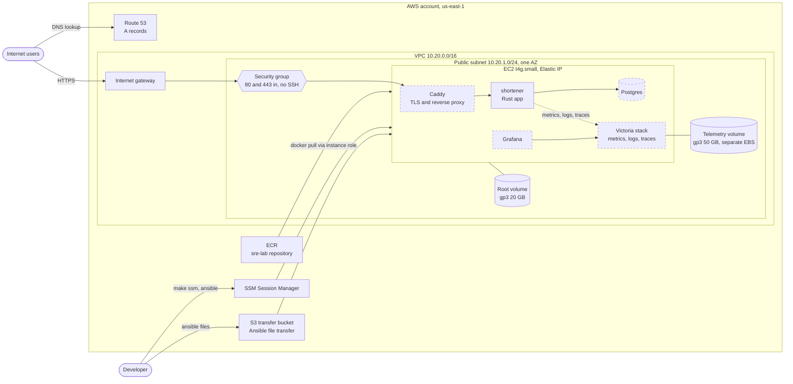
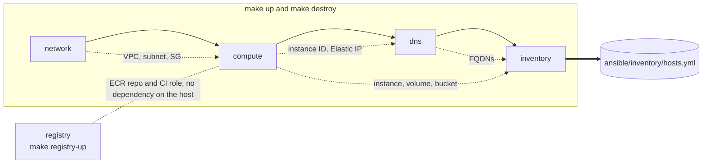
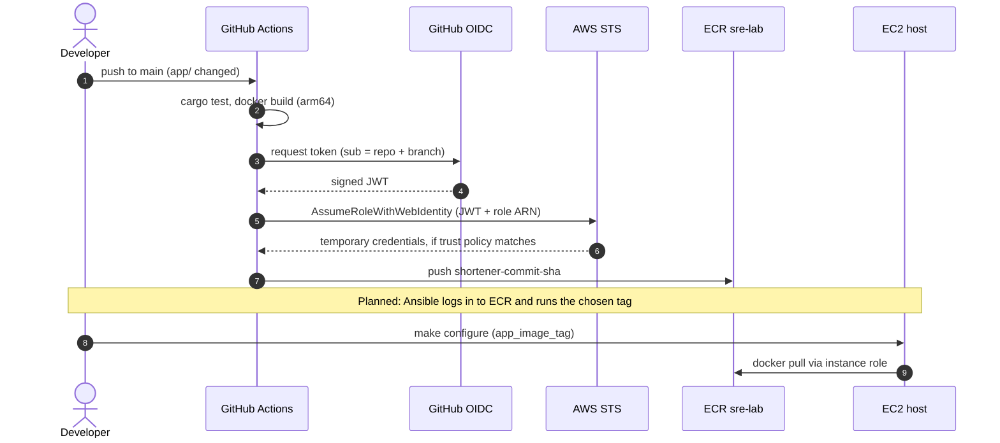
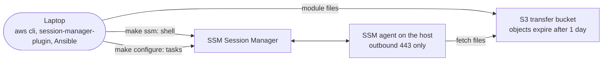
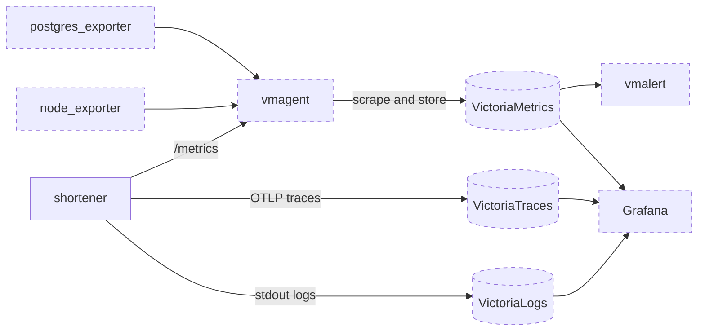

# Architecture

Visual map of the whole project. Diagrams are [Mermaid](https://mermaid.js.org/), which GitHub renders directly in Markdown. **Dashed outlines are planned, not built yet.**

## System architecture

Everything runs on one small Graviton instance. Terraform builds the AWS pieces, Ansible configures the host, and GitHub Actions publishes the app image.

| Piece | Status | Defined in |
|---|---|---|
| VPC, subnet, security group (no SSH) | built | `terraform/modules/network` |
| Instance, Elastic IP, EBS volumes, IAM, S3 transfer bucket | built | `terraform/modules/compute` |
| Route 53 records | built | `terraform/modules/dns` |
| ECR repository, GitHub OIDC role | built | `terraform/modules/ecr`, `github_oidc` |
| Base host config (disk, swap, Docker) | built | `ansible/roles/base` |
| Shortener app (in-memory storage) | built, not deployed | `app/` |
| Caddy and TLS, Postgres, deploy role | planned | |
| Victoria stack and Grafana | planned | |

## Terraform stacks

Each stack is its own root config with local state. `make up` applies the first row in order and `make destroy` reverses it. The registry stack is separate, so tearing down the host keeps your images and the CI role.

Dotted arrows show data passed through `terraform_remote_state`. `registry` shares nothing with the host stacks except a naming convention: the instance role may pull from the repository named `sre-lab`.

## Image build and deploy

Pull requests run the tests and build the image but skip the AWS steps, so they never push.

## How the host is managed

There is no SSH and no inbound management port. Both the shell and Ansible go out through SSM.

## Observability data flow (planned)

Metrics are pulled and traces and logs are pushed. The app is the only service that needs instrumenting.

All of it is stored on the separate telemetry volume so it can be resized or snapshotted without touching the OS disk.
